 

<code>Python</code> · <code>TypeScript</code> · <code>Machine Learning</code> · <code>Data Visualization</code> · <code>Web Audio</code>

<a href="#中文">中文</a> · <a href="#english" lang="en" translate="no">English</a>

##  你好

我是 **Zixuan Li**，也可以叫我 **Jace**，在 UNSW 学习 Business Analytics。

我喜欢把数据变清楚，也喜欢跟着音乐跳舞，所以会写一些把两者连在一起的小工具。

> **Make data clear. Make insight actionable.**

###  我在关注

`数据分析与可视化` · `机器学习与风险预测` · `音频与节拍分析` · `AI 与社会`

##  精选项目

<table width="100%">
  <tr>
    <td colspan="2" valign="top">
      <h3> <a href="https://github.com/osophy/BeatTrace">BeatTrace</a></h3>
      
帮 freestyle 舞者听清一首歌的节拍、层次和变化，动作选择仍然留给舞者。浏览器端 DSP 分析节拍、能量与频段，可选本地 Demucs 分轨、BeatNet 节拍和 Basic Pitch 旋律识别，所有分析都在本地完成。

      
      
      
      
    </td>
  </tr>
  <tr>
    <td width="50%" valign="top">
      <h3> <a href="https://github.com/osophy/ai-sovereignty-dashboard">AI Sovereignty Dashboard</a></h3>
      
<em>Who holds the intelligence?</em> 一个关于 AI 主权的问卷数据看板：对比本地与国外 AI 的选择，呈现隐私顾虑和观察到的模式，支持筛选与搜索。

      
      
    </td>
    <td width="50%" valign="top">
      <h3> <a href="https://github.com/osophy/stock-pledge-default-prediction">股权质押违约预测</a></h3>
      
基于 1,442 家上市公司的财务与经营指标，对比 6 类模型预测股权质押违约风险。AdaBoost 的 ROC-AUC 达到 0.996，违约召回率 88.7%。

      
      
      
    </td>
  </tr>
  <tr>
    <td width="50%" valign="top">
      <h3> <a href="https://github.com/osophy/jace-li-portfolio">Portfolio</a></h3>
      
我的个人作品集网站，集中展示数据分析与开发项目。

      
      
    </td>
    <td width="50%" valign="top">
      <h3> <a href="https://github.com/osophy/CC">番茄钟</a></h3>
      
一个桌面番茄钟应用，专注与休息自动切换，深色界面。

      
      
    </td>
  </tr>
</table>

###  联系我

欢迎聊数据、音乐和舞蹈：[zixuanli0508@outlook.com](mailto:zixuanli0508@outlook.com)

##  Hello

I'm **Zixuan Li**, or just **Jace**, studying Business Analytics at UNSW.

I like making data clear and moving to music, so I build small tools that connect the two.

> **Make data clear. Make insight actionable.**

###  What I'm into

`Data analysis & visualization` · `Machine learning & risk prediction` · `Audio & beat analysis` · `AI & society`

##  Selected Projects

<table width="100%">
  <tr>
    <td colspan="2" valign="top">
      <h3> <a href="https://github.com/osophy/BeatTrace">BeatTrace</a></h3>
      
Helps freestyle dancers hear a song's pulse, layers and changes, while leaving movement choices to the dancer. Browser DSP covers beats, energy and frequency bands, with optional local Demucs stems, BeatNet beats and Basic Pitch melody. Everything runs locally.

      
      
      
      
    </td>
  </tr>
  <tr>
    <td width="50%" valign="top">
      <h3> <a href="https://github.com/osophy/ai-sovereignty-dashboard">AI Sovereignty Dashboard</a></h3>
      
<em>Who holds the intelligence?</em> A survey dashboard on AI sovereignty: local vs. foreign AI choices, privacy concerns and observed patterns, with filters and search.

      
      
    </td>
    <td width="50%" valign="top">
      <h3> <a href="https://github.com/osophy/stock-pledge-default-prediction">Stock Pledge Default Prediction</a></h3>
      
Predicts equity-pledge default risk from financial and operating metrics of 1,442 listed companies, comparing six model families. AdaBoost reaches 0.996 ROC-AUC with 88.7% default recall.

      
      
      
    </td>
  </tr>
  <tr>
    <td width="50%" valign="top">
      <h3> <a href="https://github.com/osophy/jace-li-portfolio">Portfolio</a></h3>
      
My personal portfolio site, bringing together my data analytics and development work.

      
      
    </td>
    <td width="50%" valign="top">
      <h3> <a href="https://github.com/osophy/CC">Pomodoro Timer</a></h3>
      
A desktop Pomodoro timer that switches between focus and break sessions, with a dark interface.

      
      
    </td>
  </tr>
</table>

###  Get in touch

Happy to chat about data, music and dance: [zixuanli0508@outlook.com](mailto:zixuanli0508@outlook.com)

  

